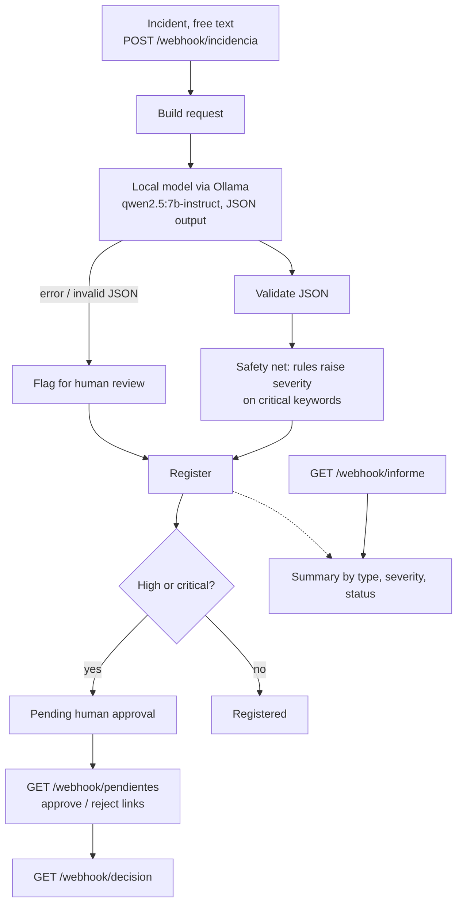

# Ramp Operations Assistant — n8n + local LLM

An n8n workflow that receives free-text operational incidents (in Spanish), classifies them with a **local LLM**,
forces a **human approval** step for anything serious, keeps a register, and produces an aggregate report.
It is measured with held-out test cases, not by eye.

> **All data is synthetic.** Nothing here comes from a real airline, handler, flight, person or procedure.
> Incident texts, labels and code comments are in Spanish (the language of the use case).

## Why

In ground (ramp) operations, incidents arrive as free text: radio, messages, notes. Sorting them by hand is slow,
and a serious one can slip through. The goal is a uniform register where **a person always sees what is serious**.

## How it works



Design principles:
- **An incident is never lost.** If the model fails, it is still registered and goes to human review.
- **Human approval is mandatory** for severity `alta` / `critica`.
- **When in doubt, a false alarm beats a missed serious case.** A rule-based safety net runs *after* the model.
- **The classifier is swappable:** the model name and Ollama URL are constants in `n8n/generar_workflow.py`; point them at another local model or a cloud API and regenerate.

Labels: type ∈ `equipaje`, `carga_balance`, `equipo_gse`, `seguridad_prl`, `personal`, `documentacion`, `otro`;
severity ∈ `baja`, `media`, `alta`, `critica`.

## Results

| System / test set | Type | Severity | Approval | Serious cases missed |
|---|---|---|---|---|
| Rules, the 30 cases they were written on | 90 % | 83 % | 97 % | 1 |
| Rules, 15 unseen cases | 20 % | 40 % | 60 % | 6 |
| Local 3B model, 15 unseen cases | 60 % | 40 % | 80 % | 1 |
| Local 7B model, 15 unseen cases | 67 % | 67 % | 80 % | 1 |
| 7B + safety net, validation (15) | 67 % | 80 % | 87 % | 0 |
| **7B + safety net, final test (15, run once)** | **80 %** | **80 %** | **93 %** | **0** |

What it shows: hand-written rules overfit (90 % → 20 % on unseen cases); the model generalises better; a simple
safety net removes the grave error. The final-test row is the trustworthy one: prompt and rules were not touched after seeing it.
The n8n workflow reproduces the Python script's numbers.

## Limitations (honest)

- **Small sample:** 15 + 15 cases, written by the same person who built the system. Numbers are indicative, not a guarantee.
  Next step: cases written by someone else, a larger or fine-tuned model.
- Remaining errors: type confusion (documentation vs. load) and severity somewhat over-estimated (T02, T05, T08).
- Persistence is n8n's built-in SQLite workflow data: fine for a demo, not for production (use Postgres or a spreadsheet).
- No notification to the supervisor yet: they open `/webhook/pendientes`. Email/chat alerts are the natural next step.

## Run it

Requirements: Node.js, [Ollama](https://ollama.com), Python 3 (standard library only).

```bash
ollama pull qwen2.5:7b-instruct

# 1. Start n8n (local, no keys needed) and create the local owner account on first visit
npx n8n start                      # http://localhost:5678

# 2. Import and publish the workflow
npx n8n import:workflow --input=n8n/workflow.json
npx n8n publish:workflow --id=opsAsistenteRampa01     # then restart n8n

# 3. Send the held-out cases and score them
python enviar_a_n8n.py datos/prueba_final_sintetica.json resultados/n8n_prueba_final.json
python -I evaluar.py resultados/n8n_prueba_final.json datos/prueba_final_sintetica.json
```

Try one incident by hand:

```bash
curl -X POST http://127.0.0.1:5678/webhook/incidencia -H "Content-Type: application/json" \
  -d '{"id":"DEMO1","texto":"Sale humo de una bodega durante la carga."}'
curl http://127.0.0.1:5678/webhook/pendientes   # approve / reject links
curl http://127.0.0.1:5678/webhook/informe      # report
```

## Repository layout

| Path | What |
|---|---|
| `n8n/workflow.json`, `n8n/generar_workflow.py` | The workflow and the generator that builds it (edit model/URL there) |
| `clasificar_ollama.py`, `red_seguridad.py`, `aplicar_red.py` | Reference classifier, safety net, and applying it to saved outputs |
| `evaluar.py` | Evaluator (type / severity / approval accuracy, missed serious cases) |
| `enviar_a_n8n.py` | Sends a case set to the webhook and stores the answers |
| `datos/` | Synthetic cases: 30 development, 15 validation, 15 final test |
| `resultados/` | Saved model and workflow outputs behind the table above |

## License

MIT — see `LICENSE`.
